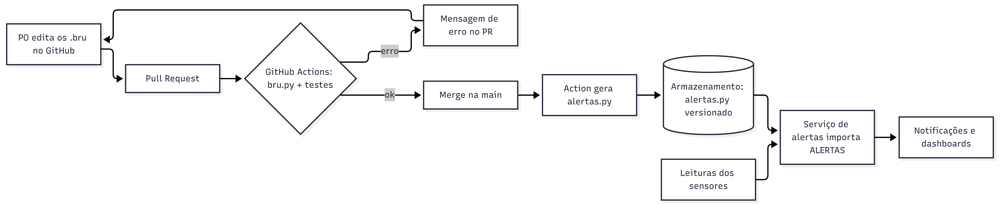

# Transpilador .bru

Linguagem simples para o PO criar alertas sem programar. O transpilador converte `alertas.bru` em Python.

Grupo: (nomes dos integrantes)

## A linguagem

```
alert temperatura_sensor;
- min: 10
- max: 80
```

- Cada alerta começa com `alert nome;`
- O nome tem letras (com ou sem acento), números e `_`, começando por letra
- Propriedades, uma por linha: `- chave: valor`
- Só `min` e `max`, com número inteiro ou decimal (pode ser negativo)
- Linhas em branco são ignoradas e `#` inicia um comentário

## Como rodar

Precisa de Python 3.12 ou mais novo, sem instalar nada.

```
python bru.py exemplos/valido1_basico.bru -o alertas.py
```

Usando o resultado:

```python
from alertas import ALERTAS

alerta = ALERTAS[0]
print(alerta.nome)            # temperatura_sensor
print(alerta.disparou(95))    # True  (acima do max)
print(alerta.disparou(50))    # False (dentro do intervalo)
```

`disparou(valor)` retorna `True` quando o valor está fora de `[min, max]`.

## Como funciona (4 etapas, cada uma em uma função de `bru.py`)

| Etapa | Função | O que faz |
|---|---|---|
| 1. Tokenizador | `tokenizar` | Texto → tokens (tipo, valor, linha) |
| 2. Parser | `parsear` | Tokens → AST (alertas e propriedades) |
| 3. Semântica | `validar` | Aplica as regras de validação |
| 4. Gerador | `gerar` | AST → código Python |

Onde cada validação acontece:

| Problema | Etapa |
|---|---|
| Caractere estranho (`$`, `@`) | Tokenizador |
| Alerta sem nome, nome com espaço, propriedade mal escrita | Parser |
| Nome inválido (ex.: `1sensor`) | Semântica |
| Nome repetido | Semântica |
| Chave diferente de min e max | Semântica |
| Chave repetida | Semântica |
| Sem min e sem max | Semântica |
| Limites invertidos | Semântica |

## Arquitetura (Desafio 2)



| Item | Como funciona |
|---|---|
| **Edição** | O PO escreve e guarda os `.bru` na pasta `alertas/` do repositório do projeto, editando direto no site do GitHub (botão de lápis), sem instalar nada. Cada mudança vai por Pull Request. |
| **Validação contínua** | O GitHub Actions roda em todo Pull Request: `bru.py` em cada `.bru` e os testes. Se falhar, o merge fica bloqueado e nada vai para produção. |
| **Feedback** | O PO vê o ✗ vermelho no próprio Pull Request e abre o log com a mensagem `arquivo:linha: erro ...`, que diz o arquivo, a linha e o problema. Ele também recebe e-mail do GitHub. |
| **Implantação** | Depois do merge na `main`, o Actions gera o `alertas.py` e o publica (ex.: bucket S3 versionado). O serviço de alertas importa `ALERTAS` ao reiniciar e usa `disparou(valor)` nas leituras dos sensores. Para voltar atrás, basta reverter o commit. |

